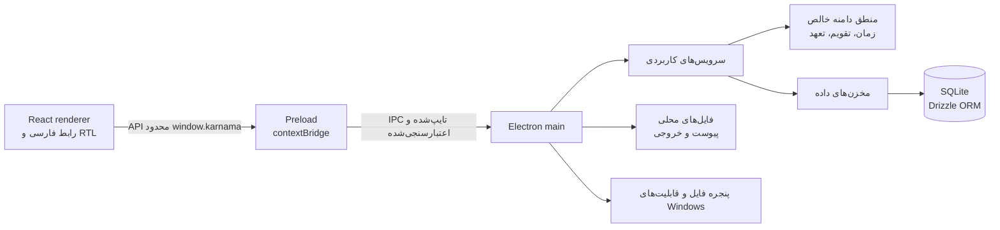
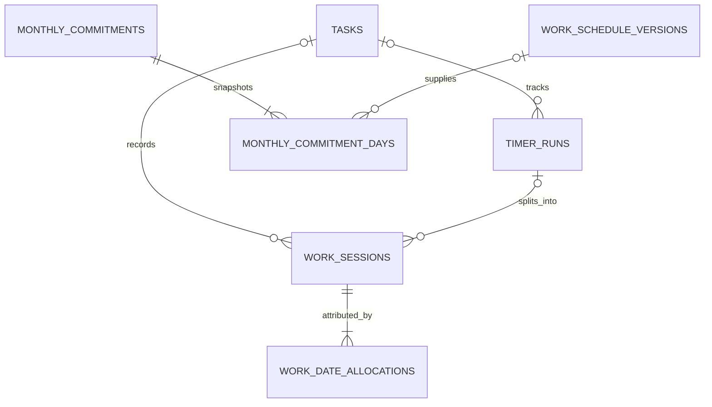

# معماری کارنما: طرح و وضعیت پیاده‌سازی

> وضعیت: Phase 4، 5 و 6 رسماً پذیرفته شدند؛ Phase 7 و قاعدهٔ گزارش‌گیری تسک بایگانی‌شده نیز پیاده‌سازی شده‌اند. برای انتشار `v0.1.0` ساخت و آزمون نصب‌کنندهٔ نهایی در `RELEASE.md` ثبت می‌شود. نصب‌کننده امضای Authenticode ندارد. این سند نیازمندی‌های محصول را تغییر نمی‌دهد.

## هدف و محدوده

کارنما یک برنامه دسکتاپ Windows، فارسی‌محور، آفلاین و تک‌کاربره است. پایگاه داده، فایل‌های پیوست و منطق دارای دسترسی سیستم فقط در فرایند اصلی Electron قرار می‌گیرند. React مسئول رابط کاربری است و از راه یک API محدود و اعتبارسنجی‌شده با فرایند اصلی ارتباط می‌گیرد.

این معماری با تصمیم‌های قطعی `Work Date`، منطقه زمانی، تایمر، تعهد ماهانه شناور و راهنمای آغاز کار هماهنگ است. پایه برنامه، مدیریت تسک و ثبت زمان، تقویم کاری و محاسبه تعهد نسخه‌دار پیاده‌سازی شده‌اند.

## بررسی محیط توسعه

بررسی روی یک محیط توسعه Windows x64 انجام شد:

| مورد | وضعیت مشاهده‌شده |
|---|---|
| سیستم‌عامل | Windows 10 Pro 26H2، build `26300.9818`، معماری `x64` |
| Node.js | `v24.13.0` |
| npm | `11.6.2` |
| pnpm | `11.25.0` در دسترس است |
| Bun | `1.4.2` در دسترس است |
| Yarn | نصب نیست |
| Git | `2.56.0.windows.2` نصب است |
| وضعیت مخزن | baseline پیش از Phase 4.0 با commit `848be7f` ثبت شده؛ Remote تعریف نشده است |
| محتوای baseline | پیش از scaffold، سند مشخصات و اسناد مرحله صفر وجود داشت؛ فایل package و کد برنامه وجود نداشت |

Node.js نصب‌شده با Vite سازگار است. نسخه‌های مرحله یک در `package.json` و `package-lock.json` pin شده‌اند؛ نسخه Node میزبان نسخه Node داخل Electron را تعیین نمی‌کند. برای وابستگی‌ها از npm استفاده شده است.

## نتیجه بررسی راه‌اندازی Phase 4.0 — 2026-11-22

- میزبان Windows x64 و Electron `45.4.1` x64 هستند. Visual C++ Runtimeهای `vcruntime140.dll`، `vcruntime140_1.dll` و `msvcp140.dll` با نسخه `14.51.36247.0` نصب‌اند؛ وضعیت Defender فعال است و policy مؤثر AppLocker قاعده‌ای ندارد.
- همان `electron.exe --version` در فرایند low-integrity Codex با `EXCEPTION_BREAKPOINT` و کد `-2147483645` خارج شد؛ اجرای همان فایل از مسیر موقت عادی Windows با medium integrity نسخه `v45.4.1` را با exit `0` چاپ کرد. حالت Node نیز موفق است. این مقایسه علت را به محدودیت اجرای Codex/AppContainer نسبت می‌دهد، نه نصب Electron یا کد برنامه.
- در Application Error و WER برای ۴۸ ساعت اخیر رخداد منطبق با Electron پیدا نشد؛ در نتیجه Faulting Module مستقلی ثبت نشده است. اجرای `--disable-gpu` در محیط محدود هم نتیجه را عوض نکرد.
- `npm run dev` در اجرای خارج از محدودیت Codex پنجره ساخت؛ Renderer به Vite وصل شد و Shell فارسی RTL بدون خطای React Refresh دیده شد. E2E، خواندن/ذخیره تنظیمات از IPC و ماندگاری پس از restart را تأیید کرد.
- Vite React Refresh یک inline preamble ثابت می‌افزاید. CSP توسعه آن را مسدود می‌کرد؛ hash دقیق همان اسکریپت به CSP توسعه در main و meta صفحه اضافه شد. مجوز کلی `unsafe-inline` برای script اضافه نشد و CSP تولید تغییر نکرد.
- selectorهای مبهم آزمون E2E به عنصر داخل `main` و متن دقیق محدود شدند. `npm run typecheck`، `npm run lint`، `npm run format:check`، `npm test` (۳۶ تست) و `npm run test:e2e` موفق‌اند.
- تنظیمات پنجره دست‌نخورده‌اند: `contextIsolation: true`، `sandbox: true`، `nodeIntegration: false` و `webSecurity: true`. نسخه Electron و وابستگی‌ها تغییر نکردند.
- پس از انتقال build به نشست عادی Windows، `electron-builder --dir` با موفقیت بسته unpacked تازه ساخت. اجرای همان `کارنما.exe` از مسیر `app://karnama/index.html` پنجره و Renderer RTL را بار کرد؛ preload در دسترس بود و `settings.get` از IPC نتیجه موفق برگرداند. خطای DNS قبلی از محدودیت شبکه همان sandbox ناشی می‌شد.

برای اجرای Electron در این محیط توسعه، فرمان‌ها را از نشست عادی Windows بیرون از sandbox کم‌سطح Codex اجرا کنید. این محدودیت با تنظیمات امنیتی برنامه ارتباط ندارد.

## وضعیت پیاده‌سازی مرحله یک

| لایه | پیاده‌سازی ثبت‌شده |
|---|---|
| ابزارها | Electron `45.4.1`، React `19.3.1`، Vite `8.3.8`، electron-vite `6.0.0`، Tailwind `4.3.5`، TypeScript `5.9.3` |
| داده و قرارداد | SQLite از طریق `better-sqlite3 13.2.0` و Drizzle `0.45.4`؛ Zod `4.6.7`؛ migration آغازین در `drizzle/` |
| رابط | Lucide `1.77.0`، Vazirmatn محلی از `@fontsource-variable/vazirmatn 5.3.0`، تنظیمات shadcn/ui و اجزای پایه محلی Button/Card/Input/Select |
| آزمون و بسته‌بندی | Vitest `5.1.1`، Playwright `1.65.1`، Electron Builder `26.18.0`؛ خروجی unpacked با `npm run build` در `dist/win-unpacked/` |

`npm run typecheck`، `npm run lint`، `npm run format:check` و ۷ تست واحد موفق‌اند. `npm run build` موفق شده و برنامه بسته‌بندی‌شده به‌صورت دیداری اجرا و بررسی شده است. اجرای Dev تأیید نشده: main/preload و Vite آماده می‌شوند اما Electron پیش از نمایش پنجره با کد ۱ خارج می‌شود و علت در خروجی روشن نیست. Playwright E2E هم تأیید نشده: launcher پیش‌فرض در این محیط به‌دلیل ACL دسترسی AppContainer به Electron runtime خطای sandbox می‌دهد؛ harness آزمایشی بدون sandbox hang کرد. sandbox خود برنامه خاموش نشده است. خروجی فعلی پوشه unpacked است؛ installer NSIS و امضای کد هنوز تولید نشده‌اند.

### وضعیت مرحله دو

- CRUD تسک با بایگانی/بازیابی، ثبت دستی ویرایش‌پذیر، تاریخچه، تایمر سراسری، بازیابی crash و تخصیص Work Date پیاده‌سازی شده‌اند.
- تنها یک run می‌تواند `running` باشد. شروع run تازه، run pauseشده را می‌بندد و sessionهای ثبت‌شده را نگه می‌دارد. برای آرشیو تسکی که timer run باز دارد، ابتدا باید آن run متوقف شود.
- در اجرای تمیز، segment جاری تا زمان خروج ذخیره و run pause می‌شود. پس از crash زمان تا checkpoint حفظ می‌شود و downtime تا تصمیم کاربر مشکوک باقی می‌ماند.
- مدت session از timestampهای UTC با میلی‌ثانیه محاسبه می‌شود. فرم ویرایش دقت زیر دقیقه را حفظ می‌کند؛ ساعت‌های DST ناموجود رد و ساعت‌های تکراری با انتخاب صریح ثبت می‌شوند.
- موفق: typecheck، lint، format check و ۲۲ تست واحد در ۵ فایل.
- موفق: `npm run build:app`، شامل build تولیدی main، preload و renderer. بسته‌ی unpacked در `dist-phase2/win-unpacked/` با اجرای Electron Builder و skip کردن ویرایش/امضای فایل ساخته شد. اجرای برنامه بلافاصله با exit code ویندوز `-2147483645` خاتمه یافت و پنجره‌ای نساخت؛ بنابراین بازبینی دیداری صفحه‌های Phase 2 تأیید نشده است.
- اجرای معمول `npm run build` در پوشه خروجی قبلی هنگام حذف `dist/win-unpacked/debug.log` با `EBUSY` متوقف شد؛ خروجی دوم برای اجتناب از فایل قفل‌شده استفاده شد. `npm run dev` و Playwright E2E هم محدودیت‌های ثبت‌شده مرحله یک را دارند.

### وضعیت مرحله سه

- برنامه هفتگی با نسخه‌های تاریخ‌اثر، تعطیلی هفتگی، تنظیم ساعات، استثنای ساعات روز، مرخصی، تعطیلی و مرز Work Date تاریخ‌دار به schema افزوده شدند.
- `monthly_commitments` و `monthly_commitment_days` هر دو revision و روزهای snapshot را نگه می‌دارند. تغییر schedule/مرخصی/تعطیلی از تاریخ جاری به بعد یک revision تازه می‌سازد و روزهای قبل از تاریخ اثر را کپی می‌کند؛ اصلاح گذشته نیازمند `allowHistorical` صریح است.
- هدف ماهانه مستقل از هدف روزانه قابل override است. actual از allocationهای ثبت‌شده می‌آید؛ segment تایمر جاری به‌صورت موقت و بدون درج session دوباره به summary افزوده می‌شود.
- Calendar Date فعالیت با شکستن timestamp session در نیمه‌شب محلی session محاسبه می‌شود؛ Work Date از `work_date_allocations` و مرزهای روز به‌دست می‌آید. هر دو در DTO تقویم جدا هستند.
- `jalaali-js@2.0.1` در shared domain تبدیل Jalali/Gregorian را انجام می‌دهد. شبکه UI شنبه‌محور است؛ تاریخ ISO میلادی تنها تاریخ ذخیره‌شده است.
- تعطیلات رسمی از قبل seed نمی‌شوند؛ تاریخ تعطیلی عمومی/شخصی را کاربر وارد می‌کند تا داده ساختگی نمایش داده نشود.
- موفق: typecheck، lint، format check، build تولیدی main/preload/renderer و ۳۶ تست در ۷ فایل. E2E پیش از نمایش پنجره با exit code `2147483651` (`0x80000003`) متوقف شد؛ کیفیت دیداری فازهای دو و سه در این محیط تأیید نشده است.

### ساختار واقعی پوشه‌ها

این درخت وضعیت پیاده‌سازی تا پایان مرحله سه را نشان می‌دهد.

```text
.
├─ src/
│  ├─ main/
│  │  ├─ db/                  # SQLite، schema، Settings، Work و Commitment services
│  │  ├─ ipc/                 # handlerهای Settings، Task، Session، Timer و Calendar
│  │  ├─ security/            # پنجره و بررسی فرستنده
│  │  └─ index.ts             # app://، پنجره و راه‌اندازی main
│  ├─ preload/                # bridge محدود و window.karnama types
│  ├─ renderer/
│  │  ├─ index.html
│  │  └─ src/
│  │     ├─ app/              # root app و routes
│  │     ├─ components/       # shell، Header، Sidebar و UI پایه
│  │     ├─ features/         # dashboard، calendar، settings، tasks و timer
│  │     ├─ lib/              # client API، زمان و ابزارها
│  │     └─ styles/
│  └─ shared/                 # قراردادهای Zod و منطق Calendar/Work Date/time
├─ drizzle/                   # migration و metadata Drizzle
├─ tests/unit/                # settings، IPC، security، زمان و سرویس کار
├─ tests/e2e/                 # Playwright shell flow؛ در این میزبان تأیید نشده
├─ .impeccable/config.json
├─ electron.vite.config.ts
├─ electron-builder.yml
├─ package.json
└─ package-lock.json
```

در بسته‌بندی Electron Builder، rebuild خودکار npm خاموش است چون نسخه pinned از `better-sqlite3` برای Electron 45 با Node-API prebuild اجرا شد. تغییر نسخه driver یا Electron این فرض را دوباره نیازمند بررسی build و اجرای واقعی DB می‌کند.

## معماری کلان



مرز مسئولیت‌ها:

- **Renderer:** نمایش داده، تعامل کاربر، فرم‌ها، قالب‌بندی و وضعیت موقت رابط. محاسبه نهایی ساعات، دسترسی فایل، SQLite و APIهای Node در این لایه نیست.
- **Preload:** فقط توابع محدود و نام‌دار را روی `window.karnama` عرضه می‌کند؛ کانال خام IPC یا شیء `ipcRenderer` را در اختیار React نمی‌گذارد.
- **Main:** مالک پنجره‌ها، اعتبارسنجی پیام‌ها، خدمات برنامه، پایگاه داده، تایمر پایدار، انتخاب فایل و خروجی گرفتن است.
- **Domain:** توابع TypeScript خالص و مستقل از Electron/React/SQLite برای مدت‌زمان‌ها، تقویم و تعهد کاری. این لایه منبع یگانه محاسبات تجاری است.
- **Database:** فقط از سرویس‌ها و repositoryهای main قابل دسترسی است؛ renderer هیچ اتصال یا مسیر فایلی دریافت نمی‌کند.

برای ساخت renderer، main و preload از `electron-vite` استفاده شده؛ بسته‌بندی Windows با Electron Builder انجام می‌شود. نسخه Electron و وابستگی‌ها در lockfile ثبت شده‌اند.

driver پیاده‌شده `better-sqlite3` با adapter رسمی Drizzle است. پرس‌وجوها باید کوتاه بمانند چون driver synchronous است. نسخه فعلی با Node-API prebuild در Electron 45 و بسته Windows اجرا شد؛ در صورت تغییر نسخه Electron/driver باید این سازگاری دوباره بررسی شود.

Migration آغازین در بسته برنامه قرار می‌گیرد و main آن را هنگام راه‌اندازی اجرا می‌کند؛ نسخه نهایی به Drizzle Kit یا اینترنت وابسته نیست.

## طراحی اولیه پایگاه داده

### قراردادهای ذخیره‌سازی

- شناسه `user_profile` و `app_settings` singleton عددی `1` است؛ `app_metadata` از کلید متنی استفاده می‌کند. موجودیت‌های task، session، timer run، schedule و snapshot شناسه UUID دارند که در main ساخته می‌شوند.
- تاریخ‌های روزانه و تقویمی با متن ISO میلادی `YYYY-MM-DD` ذخیره شوند؛ تبدیل جلالی فقط برای ورودی و نمایش است.
- زمان‌های لحظه‌ای با عدد صحیح epoch میلی‌ثانیه UTC ذخیره شوند و نام ستون پسوند `_utc_ms` داشته باشد. تبدیل به تاریخ/ساعت محلی فقط با منطقه زمانی مشخص انجام شود.
- شناسه منطقه زمانی، نام IANA مانند `Asia/Tehran` باشد؛ offset ثابت مانند `+03:30` برای تفسیر برنامه آینده کافی نیست.
- زمان تعهد و تخمین‌ها عدد صحیح دقیقه باشند. مدت واقعی از تفاضل timestampهای خام محاسبه شود؛ هر جلسه جداگانه گرد نشود.
- `work_sessions.time_zone_id` منطقه زمانی‌ای را ثبت کند که هنگام ایجاد/ثبت جلسه استفاده شده است تا تغییر بعدی تنظیمات، روز کاری گذشته را جابه‌جا نکند.
- فعال‌کردن `PRAGMA foreign_keys`, تنظیم `busy_timeout` و اجرای migrationهای شماره‌دار بخشی از راه‌اندازی DB باشد. اتصال DB فقط در main باز بماند.
- مرحله یک سه جدول `user_profile`, `app_settings` و `app_metadata` را ساخت؛ مرحله دو مدل تسک، timer، session و allocation را افزود؛ مرحله سه جدول‌های schedule، holiday، leave، override و snapshot تعهد را اضافه کرد. فایل DB در `app.getPath('userData')` است؛ timezone اولیه با `Intl.DateTimeFormat().resolvedOptions().timeZone` تشخیص داده می‌شود.
- مقدارهای اولیه: عنوان شغلی `Product Designer`، تعهد ۴۸۰ دقیقه، روزهای ISO `[6,7,1,2,3,4]`، تعطیلی هفتگی `5`، تقویم `jalali`، تم `system` و `work_day_boundary_minutes=360`. `user_profile.display_name` می‌تواند خالی باشد. `app_settings` یک flag/timestamp برای پایان راهنمای نخستین‌اجرا نگه می‌دارد.
- `app_metadata` فقط کلیدهای `database_id` (UUID) و `initialized_at` (رشته ISO 8601 با `Z`) را دارد؛ شماره migration در جدول داخلی Drizzle ثبت می‌شود. Schemaهای Tasks و Work Sessions در فاز یک ساخته نمی‌شوند.

### موجودیت‌ها و ارتباط‌ها

| موجودیت | نقش و رابطه‌های اصلی |
|---|---|
| `user_profile` | ردیف singleton؛ نام کاربر و عنوان شغلی پیش‌فرض Product Designer |
| `app_settings` | تنظیم‌های پایدار: تعهد پیش‌فرض ۴۸۰ دقیقه، روزهای کاری، تعطیلی هفتگی، مرز Work Date (۳۶۰ دقیقه از نیمه‌شب)، تقویم، تم، IANA timezone و تکمیل راهنمای نخستین‌اجرا |
| `app_metadata` | شناسه نصب و زمان نصب؛ نسخه schema از دفتر migration Drizzle خوانده می‌شود تا دو مرجع نسخه‌گذاری نسازیم |
| `tasks` | تسک مستقل با عنوان، توضیح، یادداشت، وضعیت (`todo`, `in_progress`, `waiting_feedback`, `on_hold`, `done`)، اولویت، تخمین، زمان‌های ایجاد/تکمیل و `archived_at_utc_ms`؛ بایگانی به‌جای حذف، sessionها را حفظ می‌کند و قابل‌بازیابی است |
| `task_links` | چند پیوند Figma یا خارجی برای هر تسک |
| `attachments` | چند تصویر محلی و توضیح برای هر تسک؛ مسیر نسبی خصوصی در کنار metadata |
| `timer_runs` | اجرای منطقی تایمر؛ تسک اختیاری، وضعیت، منطقه زمانی، مرز Work Date snapshot و وضعیت بازیابی؛ حداکثر یک اجرا `running`؛ شروع اجرای تازه، اجرای قبلیِ `paused` را می‌بندد و segmentهای ثبت‌شده آن را نگه می‌دارد |
| `work_sessions` | بازه واقعی پیوسته؛ تسک اختیاری برای فعالیت عمومی، منبع دستی/تایمر، آغاز/پایان UTC، IANA timezone snapshot و `timer_run_id` اختیاری |
| `work_date_allocations` | تخصیص پایدار هر session به یک یا چند `work_date`؛ هر ردیف شامل بازه UTC بخش، تاریخ کاری ISO، ترتیب و منبع تخصیص است |
| `work_schedule_versions` | نسخه زمان‌بندی مؤثر از یک Work Date شامل timezone، مرز روز، هدف روزانه، تعطیلی هفتگی و روزهای کاری ISO |
| `work_date_overrides` | هدف دقیقه‌ای صریح یک Work Date؛ مقدار صفر روز بدون تعهد و مقدار مثبت استثنای ساعات است |
| `monthly_commitments` | revision مستقل هر دوره؛ `calendar` و `period_key` دوره Jalali/Gregorian را مشخص می‌کنند و `override_minutes` می‌تواند هدف ماهانه را جایگزین جمع روزها کند |
| `monthly_commitment_days` | snapshot روزانه‌ی `scheduled_minutes`، `approved_leave_minutes`، `target_minutes` و schedule version برای بازسازی تاریخچه |
| `work_date_boundary_overrides` | مرز روز کاری ویژه برای یک Work Date؛ دقیقه از نیمه‌شب در منطقه زمانی مؤثر |
| `leave_entries` | مرخصی با نوع کامل/نیم‌روز/دقیقه دلخواه و وضعیت؛ بازه به ردیف‌های روزانه با `group_id` مشترک گسترش می‌یابد |
| `holidays` | تعطیلی عمومی یا شخصی روی تاریخ ISO؛ فهرست نمونه/خودکار به DB seed نمی‌شود |

در پیاده‌سازی فعلی بایگانی به‌صورت پیش‌فرض جای حذف را می‌گیرد و sessionها به تسک متصل می‌مانند؛ restore هم از UI در دسترس است. اگر در آینده حذف قطعی افزوده شود، FK جلسه باید با `SET NULL` زمان ثبت‌شده را نگه دارد. فایل فیزیکی پیوست پس از commit پایگاه داده حذف و خطای ناقص پاک‌سازی شود.



`work_date_overrides`، `leave_entries`، `holidays` و `work_date_boundary_overrides` با تاریخ ISO روی snapshot روز join می‌شوند؛ این‌ها رکوردهای منبع مستقل‌اند تا داده‌های ثبت‌شده قابل بازبینی بمانند. `task_links` و metadataهای `attachments` با FK به تسک متصل‌اند؛ بایت تصویر زیر `userData/attachments` نگه‌داری می‌شود و مسیر فایل در DTO renderer افشا نمی‌شود. `report_snapshots` خروجی‌های پایدار را ثبت می‌کند. backupهای ZIP زیر `userData/backups` قرار دارند و شامل DB و attachmentهای ارجاع‌شده با manifest/SHA-256 هستند.

در `work_date_allocations`، بازه UTC یک بخش واقعی با `work_date` ISO و `source` از نوع `boundary` یا `manual` ذخیره می‌شود. زمان جلسه اصلی جدا می‌ماند. تخصیص‌های خودکار باید پوشش کامل و بدون هم‌پوشانی داشته باشند؛ تخصیص دستی یک بازه کامل برای یک تاریخ دارد.

### قیود و indexهای پیشنهادی

- `CHECK` برای وضعیت‌های enum، محدوده دقیقه روز/مرز، زمان‌های مثبت جلسه و `custom_minutes` مرخصی؛ هر دوره تعهد، تاریخ آغاز/پایان ISO معتبر دارد.
- کلید خارجی `work_sessions.task_id` و `timer_runs.task_id` با `ON DELETE SET NULL`؛ `monthly_commitment_days` به revision ماه با `ON DELETE CASCADE` متصل است.
- index یکتای partial روی `timer_runs` با شرط `status = 'running'` در migration جاری حداکثر یک تایمر فعال را enforce می‌کند. هر segment بسته یک `work_sessions` مستقل دارد؛ گذار وضعیت و درج session داخل transaction تکرار ناشی از pause/crash را مهار می‌کند. مدل فعلی ستون segment index روی session ندارد.
- `UNIQUE(session_id, segment_index)` برای Work Date allocationها؛ هر allocation باید داخل بازه UTC جلسه اصلی باشد و allocationهای خودکار باید بدون gap/overlap کل session را پوشش دهند.
- indexهای `work_sessions(start_utc_ms, end_utc_ms)`, `work_sessions(task_id, start_utc_ms)`, `work_date_allocations(work_date)`, `leave_entries(work_date, status)`, `holidays(work_date)`, `work_date_overrides(work_date)`, `work_date_boundary_overrides(work_date)` و `monthly_commitment_days(work_date)`.
- indexهای یکتا برای `(calendar, period_key, revision)`, `(commitment_id, work_date)` و `leave_entries(group_id, work_date)`؛ index یکتای partial حداکثر یک revision جاری برای هر `(calendar, period_key)` را نگه می‌دارد.
- SQLite قید exclusion برای بازه‌های هم‌پوشان عمومی نمی‌دهد؛ سرویس ثبت/ویرایش جلسه پیش از درج، در transaction نوشتن، شرط بازه نیمه‌باز را بررسی کند. هم‌پوشانی بین تایمر جاری و session دستی هم همین مسیر را طی کند.

قیود در migrationهای `drizzle/0000` تا `drizzle/0005` نگهداری می‌شوند؛ schema TypeScript مرجع جاری برنامه است.

## مدل محاسبات زمان و تعهد کاری

### تفکیک Calendar Date و Work Date

- `Calendar Date` از timestamp واقعی در timezone snapshotشده همان session به‌دست می‌آید و برای تایم‌لاین تقویم است.
- `Work Date` تاریخ ISO میلادی‌ای است که سهم زمان جلسه به آن گزارش می‌شود. برنامه فقط هنگام ساخت session از مرزهای تنظیم‌شده برای محاسبه اولیه استفاده می‌کند؛ سهم‌ها در `work_date_allocations` ذخیره می‌شوند تا تغییرات بعدی timezone یا مرز، گزارش گذشته را جابه‌جا نکند.
- مرز پیش‌فرض ابتدای Work Date برابر 06:00 محلی است. هر بازه از مرز یک Work Date تا مرز Work Date بعدی، به همان Work Date تعلق دارد؛ پس فعالیت بین 00:00 و 06:00 به Work Date قبل نسبت داده می‌شود. مرز ویژه یک تاریخ در `work_date_boundary_overrides` نگهداری می‌شود.
- session عبوری از یک یا چند مرز به چند allocation تقسیم می‌شود؛ رکورد `work_sessions` و timestampهای واقعی تغییر نمی‌کنند. تخصیص دستی کل session به یک Work Date با یک allocation تمام‌بازه‌ای و `source='manual'` ثبت می‌شود.
- گزارش روزانه/ماهانه، تعهد و تراز از allocationها و Work Date استفاده می‌کنند. تقویم فعالیت از زمان و Calendar Date واقعی استفاده می‌کند.
- تغییر Work Date تخصیص‌یافته فقط از مسیر ویرایش روشن session انجام می‌شود. تغییر مرز یا timezone، allocation گذشته را خودکار بازسازی نمی‌کند؛ بازتخصیص گذشته نیازمند تأیید است.

### بازه‌ها و تایمر

- بازه‌ها نیمه‌باز `[start, end)` باشند؛ بنابراین دو جلسه که یکی دقیقاً در لحظه پایان دیگری شروع می‌شود، هم‌پوشانی ندارند.
- شرط جلسه معتبر: `end_utc_ms > start_utc_ms`. اصلاح جلسه نیز از همان کنترل هم‌پوشانی عبور کند.
- یک اجرای تایمر می‌تواند چند بخش زمانی داشته باشد: pause بخش جاری را به `work_sessions` می‌بندد؛ resume بخش بعدی را شروع می‌کند. شروع run تازه، run pauseشده را stopped می‌کند؛ run در حال اجرا ابتدا باید pause یا stop شود. transaction مشترک، درج دوباره پس از crash را مهار می‌کند.
- `timer_runs` باید آغاز اجرای منطقی، `current_segment_started_at_utc_ms`، زمان تجمعی بخش‌های بسته‌شده، منطقه زمانی و آخرین checkpoint را نگه دارد؛ بخش جاری تا pause/stop به‌صورت بازه زنده محاسبه می‌شود.
- تایمر پس از خروج تمیز pause شود و حالت آن برای resume بماند. پس از crash، فاصله از آخرین checkpoint تا راه‌اندازی بعدی «مشکوک» است و تا تأیید کاربر به زمان واقعی اضافه نمی‌شود.
- ساعت دیواری سیستم ممکن است تغییر کند یا سیستم suspend شود. تایمر باید checkpoint و بازیابی شفاف داشته باشد؛ جمع نهایی از timestamp/segment ثبت‌شده به‌دست آید، نه تعداد tickهای UI.
- خروج تمیز برنامه segment جاری را تا لحظه خروج می‌بندد و run را pause می‌کند. پس از crash، downtime از آخرین checkpoint تا راه‌اندازی بعدی مشکوک می‌ماند و فقط با تأیید کاربر به session تبدیل می‌شود.

### تعهد و تراز

مقادیر پایه‌ای که با مشخصات محصول منطبق‌اند:

```text
تعهد روز = max(0, هدف برنامه‌ریزی‌شده روز − مرخصی تأییدشده روز)
ساعات واقعی روز = مجموع (پایان UTC − آغاز UTC) allocationهای معتبر همان Work Date
باقی‌مانده ماه = تعهد ماه − ساعات واقعی ثبت‌شده در ماه
میانگین لازم = باقی‌مانده ماه ÷ روزهای کاری باقی‌مانده
```

- جمع مدت‌ها با میلی‌ثانیه خام انجام و فقط هنگام نمایش به `HH:MM` تبدیل شود؛ جلسه‌های کوتاه جداگانه به دقیقه گرد نشوند.
- روز تعطیل/تعطیل هفتگی تعهد صفر می‌گیرد؛ کار انجام‌شده در آن روز همچنان در ساعات واقعی می‌آید و هدف روزهای دیگر را تغییر نمی‌دهد.
- مجموع مرخصی از هدف همان روز بیشتر نشود؛ آنچه بیشتر از هدف است در محاسبه صفر شود ولی رکورد اصلی برای تاریخچه باقی بماند.
- هدف ماهانه شناور و مرجع نهایی است؛ مازاد/کسری Work Dateهای همان ماه با هم جبران می‌شوند. تراز روزانه برای نمایش جدا باقی می‌ماند و تعهد به ماه دیگر carry نمی‌شود.
- ترتیب محاسبه روز: برنامه نسخه‌دار؛ تعطیلی هفتگی یا ثبت‌شده target را صفر می‌کند؛ override تاریخ‌دار صریح می‌تواند ساعات همان روز را تعیین کند؛ در پایان مرخصی تأییدشده از target کم می‌شود. مرخصی pending/rejected هدف را کم نمی‌کند.
- تراز Work Date جاری زنده است؛ تا مرز بعدی آن روز «موقت» می‌ماند و کسری آن کسری نهایی نیست. پس از مرز، در محاسبه ترازهای نهایی قرار می‌گیرد.
- اگر باقی‌مانده روز کاری صفر باشد، میانگین پیش‌بینی نمایش داده نشود. اگر تعهد ماه انجام شده باشد، UI وضعیت «تکمیل‌شده»/مازاد را جداگانه نشان دهد.
- تغییر برنامه پیش‌فرض از Work Date بعدی اثر می‌کند. برای هر دوره تقویمی snapshot روزانه و revision نگهداری می‌شود؛ بازحسابی روز گذشته فقط با اقدام صریح و revision تازه انجام می‌شود.

تعهد ماه مستقل و snapshotشده است. override ماهانه فقط تعهد کل دوره را عوض می‌کند و هدف‌های روزانه را توزیع یا بازنویسی نمی‌کند؛ به این ترتیب، مانده ماه مرجع انعطاف‌پذیر و ترازهای روزانه/تجمعی جدا باقی می‌مانند. هویت دوره با حالت تقویم فعلی و `period_key` ذخیره می‌شود؛ تغییر تنظیم تقویم می‌تواند دوره نمایشی دیگری بسازد و نیازمند تأیید محصول است.

## ذخیره‌سازی منطقه زمانی و ورود دستی

- منطقه زمانی فعلی Windows در تنظیمات آشکار و قابل تغییر است؛ در نصب اولیه از `Intl.DateTimeFormat().resolvedOptions().timeZone` مقداردهی می‌شود. مقدار IANA در profile/settings و هنگام ساخت هر session snapshot شود.
- هر نسخه schedule منطقه زمانی مؤثر خود را داشته باشد و هر جلسه نیز منطقه زمانی استفاده‌شده هنگام ثبت را snapshot کند.
- روز برنامه، Work Date، مرخصی، تعطیلی و override یک تاریخ ISO میلادی محلی هستند و به UTC تبدیل نمی‌شوند.
- در مرحله دو، تبدیل ساعت محلی دستی در `shared/domain/work-time.ts` با `Intl.DateTimeFormat` و نمونه‌گیری offsetهای محتمل برای منطقه IANA انجام می‌شود. ساعت ناموجود رد، ساعت تکراری نیازمند انتخاب زودتر/دیرتر است و زمان تا میلی‌ثانیه حفظ می‌شود. این پیاده‌سازی فعلی به polyfill وابسته نیست؛ پوشش مناطق با transitionهای تاریخی نامعمول باید هنگام گسترش آزمون‌های timezone بازبینی شود.
- فرم جلسه‌ای که از نیمه‌شب رد می‌شود تاریخ واقعی شروع و پایان را روشن کند؛ Work Date به‌طور جداگانه و قابل تغییر است. تغییر Work Date هرگز instant UTC را دستکاری نمی‌کند.
- مدت واقعی از اختلاف دو instant UTC به دست می‌آید. timezone تقویم واقعی را تفسیر می‌کند و مرزهای Work Date فقط allocation گزارش را تعیین می‌کنند.

## راهکار تقویم شمسی و میلادی

1. تاریخ canonical تمام داده‌ها ISO میلادی (`YYYY-MM-DD`) است؛ هیچ تاریخ جلالی در کلید DB یا ارتباط با سیستم‌عامل ذخیره نمی‌شود.
2. `jalaali-js@2.0.1` با الگوریتم Borkowski، ابزار واحد تبدیل و محاسبه ماه جلالی است: `toJalaali`, `toGregorian`, `jalaaliMonthLength` و اعتبارسنجی. تاریخ‌ها به شکل اجزای عددی صریح فرستاده می‌شوند؛ شیء `Date` محلی به `toJalaali` داده نمی‌شود.
3. دامنه نمایشی پیشنهادی ۱۸۰۰ تا ۲۲۵۶ میلادی است؛ این بازه برای کاربرد ثبت کار بیش از حد کافی و در مستندات کتابخانه با نتیجه `Intl` هم‌خوان اعلام شده است. ورودی نامعتبر یا بیرون از بازه با خطای فارسی رد شود.
4. تقویم جلالی grid خود را از طول ماه و روز هفته شنبه‌محور می‌سازد؛ grid میلادی نیز از محاسبات UTC روی تاریخ ISO استفاده می‌کند. تاریخ انتخابی هر دو نما ISO است.
5. `Intl.DateTimeFormat` برای قالب‌بندی فارسی، ساعت و timezone صریح استفاده می‌شود، نه برای تبدیل جلالی. برای نمایش روزِ بدون زمان، UTC صریح است تا روز بر اثر offset دستگاه جابه‌جا نشود.
6. ساعت‌ها با قرارداد `HH:MM` و جهت LTR، برچسب‌ها با ارقام فارسی و روز آغاز هفته در تقویم کارنما شنبه است.
7. در فاز تقویم، آزمون‌های مرزی نوروز، آخر ماه، سال کبیسه، تبدیل رفت‌وبرگشت، روز هفته و timezoneهای دارای DST اضافه شوند.

فرم‌های تاریخ از picker مشترک Jalali/Gregorian استفاده می‌کنند؛ خروجی ورودی همچنان به تاریخ canonical میلادی (`YYYY-MM-DD`) تبدیل می‌شود. `Intl` برای تبدیل جلالی استفاده نمی‌شود.

## معماری امن IPC

تنظیمات اجباری `BrowserWindow`:

```ts
webPreferences: {
  contextIsolation: true,
  nodeIntegration: false,
  sandbox: true,
  webSecurity: true,
}
```

قواعد مرزی:

1. `contextBridge.exposeInMainWorld` فقط APIهای نام‌دار و موردنیاز را عرضه می‌کند. در مرحله یک bridge فقط Settings را دارد؛ endpointهای Task/Timer در مراحل مربوط اضافه می‌شوند، نه به‌شکل API عمومی.
2. `ipcRenderer.invoke` تنها داخل wrapperهای مشخص preload فراخوانی شود؛ `send`, `invoke`, event bus و channel دلخواه expose نشوند.
3. ورودی هر handler در main با Zod دوباره اعتبارسنجی شود؛ مقادیر enum، طول متن، اندازه لیست و شناسه‌ها محدود باشند. خطای خروجی به DTO ساده و ثابت تبدیل شود.
4. محتوای production از protocol محلی اختصاصی `app://` بار شود؛ هر handler، `senderFrame` را با مبدأ برنامه و frame اصلی پنجره مورد انتظار بررسی کند. در dev، فقط origin محلی Vite مشخص‌شده پذیرفته شود.
5. navigation خارج از برنامه و `window.open` مسدود شود. CSP محدود و بدون `unsafe-eval` تعریف شود؛ برنامه کد اجرایی را از اینترنت بار نمی‌کند.
6. URL خارجی فقط با parse/allowlist پروتکل `https:` یا `http:` و در تعامل آشکار کاربر از `shell.openExternal` باز شود. رشته دلخواه renderer به shell داده نشود.
7. انتخاب فایل، خواندن تصویر و نوشتن فایل از dialog و APIهای main عبور کند. renderer مسیر مطلق را نفرستد یا دریافت نکند؛ attachment با شناسه قابل ارجاع باشد.
8. داده‌های عبوری plain JSON-compatible باشند (نه Node object، prototype سفارشی، `Date` یا `BigInt`). اعلان‌های async فقط payload پاک‌سازی‌شده و unsubscribe مشخص داشته باشند.

## Design System فارسی و RTL

- **زبان و جهت:** `lang="fa"`, `dir="rtl"` روی ریشه؛ متن‌های رابط از منبع ترجمه فارسی بیایند تا انگلیسی ناخواسته دیده نشود. جهت‌نماهای تصویری/آیکون فقط جایی mirror شوند که معنای حرکتی دارند. چینش با ویژگی‌های CSS منطقی مثل `margin-inline`، `padding-inline` و `text-align: start` انجام شود.
- **تایپوگرافی:** Vazirmatn به‌صورت WOFF2 محلی بسته‌بندی شود تا برنامه آفلاین بدون وابستگی به CDN باشد؛ fallback سیستم فارسی تعریف شود. وزن‌ها محدود و سلسله‌مراتب تیتر/متن/برچسب/عدد مرکزی باشد.
- **متن مختلط:** متن آزاد با `dir="auto"`; ساعت و شناسه لاتین با `dir="ltr"` یا `<bdi>` از به‌هم‌ریختگی bidi جلوگیری کنند. متن و ارقام رابط فارسی‌اند؛ مدت‌ها با چیدمان ثابت `HH:MM` نمایش داده می‌شوند.
- **لایه اجزا:** Tailwind 4 برای layout و spacing؛ پیکربندی shadcn/ui و اجزای پایه محلی Button/Card/Input/Select برای شروع؛ Lucide برای آیکون. قواعد RTL و تفاوت‌های بصری در wrapper/token مشترک پیاده شوند؛ Radix فقط همراه جزء تعاملی موردنیاز افزوده شود.
- **توکن‌ها:** سطح‌های خنثی روشن و accent اصلی Indigo؛ CSS variables برای background/foreground، surface، primary، muted، border، destructive و focus. تم تاریک foreground جداگانه برای رنگ accent دارد تا کنتراست حفظ شود. تم system از همین توکن‌ها تغذیه می‌شود.
- **چیدمان:** نوار کناری در سمت راست، فضای محتوا با تراکم مناسب دسکتاپ، جدول/تقویم با اولویت خوانایی. نمودارها جهت و tooltip فارسی داشته باشند، ولی مقدار ساعت و اعداد لاتین بمانند.
- **کیفیت پایه:** کنتراست قابل‌خواندن، focus آشکار، هدف‌های صفحه‌کلید، stateهای loading/empty/error و پیام‌های فارسی. حرکت‌ها به transitionهای کوتاه و غیرضروری محدود می‌مانند.

### Shell و راهنمای نخستین اجرا

- Sidebar سمت راست هفت مقصد محصول را نشان می‌دهد؛ Header عنوان صفحه و کنترل تم/تنظیم‌های کوتاه را نگه می‌دارد.
- داشبورد نخستین اجرا یک راهنمای صریح چهارمرحله‌ای دارد: تکمیل پروفایل، مرور ساعات کاری، ساخت اولین تسک، شروع ثبت زمان. CTA اصلی Settings را باز می‌کند و هیچ مقدار آماری مصنوعی نشان داده نمی‌شود.
- پایان راهنما با اقدام «پایان تنظیمات» در Settings در `app_settings` ثبت می‌شود. پس از آن تا ورود جلسه واقعی، داشبورد خالی می‌ماند؛ پس از وجود داده، فقط خلاصه‌های واقعی روز/ماه را نشان می‌دهد.
- Settings مقادیر پروفایل، ساعات، روزهای هفته، تعطیلی هفتگی، تقویم، تم `system/light/dark`، timezone آشکار و Work Date boundary را از IPC می‌خواند و با autosave ذخیره می‌کند.

## ریسک‌های فنی اولویت‌دار

| اولویت | ریسک | کنترل پیشنهادی |
|---|---|---|
| بالا | محاسبه تایمر و تعهد به تغییر ساعت، مرز Work Date، مرخصی و تاریخچه حساس است | allocationهای persistشده، segmentهای UTC، snapshot revision، تأیید تغییر گذشته و تست قواعد دامنه |
| بالا | drift، sleep، تغییر ساعت سیستم و crash می‌تواند تایمر را بیش‌شماری یا کم‌شماری کند | اجرای تایمر پایدار در DB، بخش‌های idempotent، checkpoint و صفحه بازیابی؛ خودداری از فرض‌کردن downtime به‌عنوان کار |
| بالا | تبدیل ساعت محلی در DST یا با تغییر timezone ممکن است ambiguous باشد | ذخیره UTC + IANA، تبدیل در یک ماژول، رد ابهام به‌جای حدس و حفظ zone هر جلسه |
| بالا | هم‌پوشانی دستی/تایمر دوباره‌شماری می‌سازد | بازه نیمه‌باز، بررسی در transaction و index مناسب؛ آزمون هم‌زمانی در لایه سرویس |
| بالا | `better-sqlite3` افزونه native است و باید برای ABI/معماری Electron بسته‌بندی شود | نسخه Electron را زود pin کنیم؛ rebuild در نصب و build Windows و smoke-check بسته واقعی |
| بالا | تغییر schedule/مرخصی می‌تواند تعهد ماه گذشته را بی‌صدا عوض کند | effective-date و snapshot روزانه نسخه‌دار؛ بازحساب گذشته فقط با اقدام صریح و audit |
| متوسط | اختلاف الگوریتم یا خطای مرز سال جلالی/میلادی | یک منبع تبدیل (`jalaali-js`)، دامنه پشتیبانی محدود و fixtureهای نوروز/کبیسه |
| متوسط | عملیات DB و فایل پیوست در یک تراکنش واحد نیست | مسیر فایل مدیریت‌شده، درج مرحله‌ای/پاک‌سازی جبرانی و بررسی یکپارچگی |
| متوسط | راست‌به‌چپِ نمودار، ارقام و متن ترکیبی ناهماهنگ می‌شود | token و wrapperهای مشترک، Vazirmatn محلی و بازبینی صفحه‌های RTL |
| بالا | اجرای Electron از محیط کم‌سطح Codex می‌تواند پیش از نمایش پنجره متوقف شود | تنظیمات sandbox برنامه را تغییر ندهیم؛ E2E و بازبینی package را از نشست عادی Windows اجرا کنیم. در این تغییر E2E اجرا شد، اما runner پیش از نمایش پنجره خارج شد |
| متوسط | PDF فارسی ممکن است فونت/شکل‌دهی/چندصفحه‌ای را خراب کند | انتخاب روش خروجی پیش از فاز پنج، جاسازی فونت محلی و بازبینی PDF رندرشده |

## پیشنهادها در برابر مشخصات محصول

| الزام محصول | تصمیم معماری |
|---|---|
| آفلاین و local-first، بدون حساب/سرور | SQLite و فایل‌های `app.getPath('userData')`؛ بدون API شبکه‌ای برای داده محصول |
| Electron + React + TypeScript + Vite | سه build مستقل main/preload/renderer و مرز روشن پردازش‌ها |
| SQLite + Drizzle و migration | Drizzle schema و SQL migration نسخه‌دار؛ دسترسی فقط از main |
| renderer بدون Node و دسترسی DB محدود | sandbox و context isolation، nodeIntegration خاموش، API allowlist و Zod در IPC |
| تسک چندروزه، جلسه دستی/خودکار و فعالیت عمومی | یک `tasks` و چند `work_sessions`؛ `task_id` برای کار عمومی null است |
| تعهد، مرخصی، تعطیلی و تاریخچه | schedule نسخه‌دار، override تاریخ‌دار و snapshot ماهانه/روزانه |
| UTC canonical + timezone کاربر، ISO میلادی + جلالی نمایشی | timestamp UTC برای instant، IANA برای تفسیر و Gregorian ISO برای تاریخ روز |
| فارسی/RTL، تقویم شمسی پیش‌فرض، ارقام لاتین | Vazirmatn محلی، `dir=rtl`, adapter تقویم و ارقام لاتین |
| گزارش PDF/HTML/JSON و backup ZIP | داده گزارش از سرویس مشترک؛ ذخیره snapshot و مدیریت فایل در main |

## تصمیم‌های قطعی ثبت‌شده برای مراحل اجرا

- `Calendar Date` زمان واقعی فعالیت را در timezone ذخیره‌شده نشان می‌دهد؛ `Work Date` کلید دسته‌بندی ساعات، تعهد روزانه و گزارش‌ها است.
- ابتدای Work Date ساعت 06:00 محلی است؛ مرز هر تاریخ قابل تغییر و دارای exception تاریخ‌دار است. بازه پیش از مرز به Work Date قبلی تعلق دارد.
- Work Date allocationها هنگام ثبت session ذخیره می‌شوند. session عبوری از مرز به بخش‌های تخصیص تقسیم می‌شود؛ تخصیص دستی کل session یک allocation می‌سازد. هیچ‌کدام timestamp واقعی را تغییر نمی‌دهند.
- تایم‌لاین تقویم بر مبنای Calendar Date است؛ گزارش‌ها بر مبنای Work Date.
- timezone سیستم در Settings دیده و قابل تغییر است؛ مقدار اولیه از Windows گرفته می‌شود و timezone هر session snapshot می‌شود.
- بعد از crash، downtime به‌طور خودکار کار محسوب نمی‌شود؛ فاصله مشکوک برای تأیید کاربر نمایش داده می‌شود.
- فقط یک timer در وضعیت running می‌ماند؛ run pauseشده با آغاز run تازه متوقف می‌شود و run جاری قبل از شروع دیگری باید pause/stop شود. خروج تمیز segment را می‌بندد و run را pause می‌کند.
- حذف تسک به‌صورت پیش‌فرض archive است؛ sessionهای مربوط حفظ می‌شوند و task قابل restore است.
- تعهد ماهانه شناور و مرجع نهایی است؛ مازاد و کسری Work Dateهای همان ماه خنثی می‌شوند، در حالی که تراز روزانه جدا می‌ماند.
- تراز Work Date جاری زنده است و تا مرز بعدی، کسری نهایی محسوب نمی‌شود.
- هر تعهد ماه مستقل و revisionدار ذخیره می‌شود؛ override ماهانه فقط total را تغییر می‌دهد و هدف‌های روزانه را تغییر نمی‌دهد. تغییرات روز گذشته و ماهی که روزهای سپری‌شده دارد با تأیید اصلاح می‌شوند.
- اضافه‌کاری Work Date تعطیل در Actual می‌آید و تعهد روزهای دیگر را خودکار کم نمی‌کند. مرخصی کامل، نیم‌روز، مدت دلخواه و بازه چندروزه پشتیبانی می‌شوند.
- داشبورد نخستین‌اجرا راهنمای شروع با چهار گام و CTA تنظیمات دارد. آمار ساختگی مجاز نیست؛ پس از تکمیل تنظیمات داشبورد واقعی تا ورود داده در وضعیت خالی می‌ماند.

## موارد تصمیم‌گیری پس از فاز سه

- آیا «ماه تعهد» باید بر اساس تقویم نمایش انتخاب‌شده تعریف شود یا یک تقویم مرجع ثابت داشته باشد؟ فعلی، override با `calendar + period_key` ذخیره می‌شود؛ تغییر تقویم ممکن است دوره و مجموع ماهانه دیگری نشان دهد.
- آیا باید فهرست تعطیلات رسمی خودکار داشته باشیم و از چه منبعی/با چه چرخه به‌روزرسانی؟ فعلی، فقط تاریخ‌هایی که کاربر ثبت می‌کند نمایش داده می‌شوند و هیچ تاریخ رسمی نمونه‌سازی نمی‌شود.
- مورد قبلی: فرم ثبت دستی session از ورودی بومی Gregorian استفاده می‌کرد؛ در Phase 7 با picker جلالی/میلادی جایگزین شد.
- محدودیت توکن low-integrity اجرای Electron از نشست Codex را متوقف می‌کرد؛ پذیرش‌های E2E و بازبینی بصری Phase 7 با پروفایل موقت و ایزوله انجام شدند.

## Phase 4 — پیوندهای تسک و پیوست تصویر (2026-11-24)

**وضعیت: معیارهای رسمی Phase 4 در 2026-11-24 پس از اجرای واقعی Electron، E2E و بازبینی دیداری پذیرفته شدند.**

- Migration افزایشی `0004_purple_risque.sql` جدول‌های `task_links` و `attachments`، کلید خارجی به `tasks`، indexهای تسک/زمان و یکتایی `storage_ref` را اضافه می‌کند. بایگانی `tasks` همچنان soft archive است و داده‌های فرزند را نگه می‌دارد.
- قراردادهای Zod در `src/shared/contracts/resources.ts` تعریف شده‌اند. Preload فقط عملیات نام‌دار لینک و تصویر را عرضه می‌کند: فهرست/ایجاد/ویرایش/حذف/بازکردن لینک، و فهرست/واردکردن/توضیح/حذف تصویر. IPC همه درخواست‌ها را با مبدأ و frame اصلی بررسی می‌کند.
- لینک در Main با `URL` trim و normalize می‌شود؛ فقط `http:` و `https:` پذیرفته می‌شوند و URL دارای credential نیز رد می‌شود. بازکردن با شناسه لینک و پس از اعتبارسنجی مجدد از طریق `shell.openExternal` انجام می‌شود.
- فایل تصویر در `app.getPath('userData')/attachments` و با نام داخلی UUID و پسوند مشتق‌شده از MIME ذخیره می‌شود. مسیر و `storage_ref` در DTO یا Preload نیستند. انتخاب چندفایلی از dialog اصلی است؛ پسوند، اندازه ۲۰ MiB، MIME مورد انتظار و امضای واقعی بایت‌ها با هم تطبیق داده می‌شوند؛ SVG پذیرفته نمی‌شود.
- واردکردن ابتدا در فایل موقت انجام می‌شود، سپس با ایجاد انحصاری فایل داخلی و درج transactionای metadata تکمیل می‌شود. خطاهای انتخاب/کپی/درج cleanup جبرانی دارند. حذف، metadata را پاک و سپس فایل را unlink می‌کند؛ reconcile ابتدای اجرا فایل موقت/یتیم را پاک و metadata بدون فایل را حذف می‌کند.
- پیش‌نمایش از `app://karnama/attachments/<uuid>` حل می‌شود، درخواست GET و referrer مبدأ برنامه را بررسی می‌کند، شناسه را به مسیر داخلی محدود می‌کند و MIME ثبت‌شده را با `nosniff` برمی‌گرداند. فایل گمشده/خراب در پاسخ پروتکل و state خطای UI گزارش می‌شود. تنظیمات BrowserWindow ثابت مانده‌اند (`contextIsolation: true`، `sandbox: true`، `nodeIntegration: false`، `webSecurity: true`)؛ CSP برای تصاویر فقط origin داخلی `app://karnama` را جهت همین فایل‌ها مجاز می‌کند.
- پنل فعلی تسک بخش‌های لینک و تصویر، فرم‌های ویرایش، حذف، empty/loading/error state، thumbnail و dialog پیش‌نمایش دارد. تسک آرشیوشده فقط‌خواندنی است و لینک‌ها/تصاویرش را حفظ می‌کند.
- `typecheck`، lint، format check، ۵۶ تست واحد و `npm run build:app` موفق‌اند. E2E کامل در PowerShell عادی با Medium integrity اجرا شد: ۳ از ۳ تست موفق؛ هیچ‌یک با `--no-sandbox` اجرا نشد و تنظیمات امنیتی Electron تغییر نکردند.
- E2E واقعی CRUD لینک، بازکردن صریح، رد نشانی بدقواره توسط فیلد URL و رد `file:`, ورود چندتصویری PNG/JPEG/WebP، رد SVG و فایل بیش از ۲۰ MiB، ویرایش توضیح، پیش‌نمایش، حذف تصویر، restart، حفظ منابع در archive و restore و فقط‌خواندنی‌بودن تسک آرشیوشده را پوشش می‌دهد. مسیر فایل و `storageRef` در DTO وجود ندارند. پنل RTL، نام/شرح بلند، تصویرهای متعدد و empty/loading/error state بازبینی شدند.
- حذف تسک طبق تصمیم محصول soft archive قابل‌بازیابی است؛ فایل‌های وابسته تا زمان نگهداری تسک آرشیوشده مدیریت‌شده باقی می‌مانند. رابط حذف دائمی تسک در این فاز وجود ندارد.
- آزمون‌ها فقط از پروفایل و DB موقت استفاده کردند. DB اصلی فقط‌خواندنی بررسی شد؛ SQLite integrity برابر `ok` و hash نسبت به baseline قبلی یکسان ماند.

## Phase 5 — تحلیل و گزارش (2026-11-24)

**وضعیت: معیارهای رسمی Phase 5 در 2026-11-24 پذیرفته شدند.** داشبورد و گزارش‌ها از داده persisted واقعی استفاده می‌کنند؛ آزمون‌های runtime از DB موقت و ایزوله استفاده کردند.

- `analytics-service` فقط در Main به SQLite دسترسی دارد. مدت‌های تاریخی از `work_date_allocations` خوانده می‌شوند؛ Work Date ذخیره‌شده دوباره با تنظیم مرز روز جاری محاسبه نمی‌شود. خلاصه تعهد و زمان واقعی روز/ماه با `commitmentService.calendarMonth` محاسبه می‌شود تا قواعد تعهد مشترک بماند.
- تایمر فعال فقط از مسیر `getCurrentTimerSegment()` افزوده می‌شود؛ segmentهای ذخیره‌شده دوباره شمرده نمی‌شوند. توزیع ساعت محلی از timezone ذخیره‌شده روی هر session و توزیع روز هفته از Work Date تخصیص‌یافته استفاده می‌کند. تایمرِ در انتظار تأیید و segment ناقص/متوقف‌شده آمار واقعی محسوب نمی‌شوند.
- DTO گزارش شامل خلاصه روز و ماه، هدف و زمان واقعی هر Work Date، فاصله هدف ثبت‌نشده، آمار ساعت/روز هفته، روند شش‌ماهه، مقایسه با ماه قبل، فعالیت تسک، انحراف برآورد از زمان واقعی عمر تسک و آمار تعداد/میانگین/بیشترین session است. تسک آرشیوشده تاریخچه را حفظ می‌کند؛ وضعیت فعلی تسک در گزارش وضعیت امروز آن است. چون تسک Work Date تکمیل جداگانه ندارد، نمایش «تکمیل‌شده امروز» از زمان تکمیل و نسخه برنامه/مرز مؤثر استنتاج می‌شود.
- ساعات شروع و پایان برنامه کاری در داده فعلی ذخیره نمی‌شوند؛ بنابراین «بازه دقیق بدون ثبت» محاسبه‌پذیر نیست. رابط مقدار تخمینی نمی‌سازد و نبود این metric را همراه علت نشان می‌دهد. ثبت زمان به‌عنوان بهره‌وری تفسیر نمی‌شود.
- APIهای محدود و نام‌دار `analytics.getPeriod` و `reports.export` از Preload عرضه شده‌اند. ورودی ماه، نوع گزارش و فرمت با Zod اعتبارسنجی می‌شود و IPC مبدأ و frame اصلی را بررسی می‌کند. Renderer به schema یا queryهای SQLite دسترسی ندارد.
- migration افزایشی `0005_aromatic_thor_girl.sql` جدول `report_snapshots` را برای snapshot داده زمان تولید، نوع گزارش و فرمت اضافه می‌کند. snapshotها از همان DTO نمایش استفاده می‌کنند؛ مسیر خروجی فایل و شناسه snapshot از HTML/PDF حذف می‌شوند.
- داشبورد، صفحه تحلیل و گزارش‌های شرکت/شخصی با نمودارهای SVG محلی، جدول روزانه، روند، heatmap و منابع تسک ساخته شده‌اند؛ وابستگی نموداری تازه اضافه نشده است. HTML خروجی مستقل است و فونت Vazirmatn و تصویرهای معتبر را به‌صورت data URI در خود دارد. لینک‌های قابل کلیک فقط HTTP(S) هستند.
- PDF با پنجره موقت محلی و مخفی Electron تولید می‌شود؛ `contextIsolation`, `sandbox` و `webSecurity` فعال و `nodeIntegration` خاموش‌اند. خروجی واقعی Electron پس از اصلاح شکست صفحه‌ها بازتولید و همه صفحات تصویری بررسی شدند: گزارش خالی ۱ صفحه و گزارش‌های شرکت/شخصی هرکدام ۳ صفحه A4؛ متن فارسی شکل‌گرفته، جدول‌های پیوسته، تصاویر/پیوندهای تسک، سرصفحه و شماره صفحه درست‌اند.
- پذیرش UI با E2E واقعی ۳/۳ موفق شد: داده روز/ماه، تاریخ تاریخی، نمایش دو تم، نمودارها/آمار تسک، تنظیم مرز روز بدون تغییر allocation تاریخی، تایمر فعال بدون دوباره‌شماری، گزارش شخصی/شرکت، خروجی HTML/PDF و دوره خالی. E2E با داده واقعی SQLite در پروفایل موقت اجرا شد.
- اصلاح‌های پذیرش در قالب گزارش: رفع metric تکراری/جاافتاده، جلوگیری از جداشدن عنوان بخش از محتوا، نگه‌داشتن نمودار روند شخصی در یک صفحه، و اصلاح هدر PDF/جهت footer و شماره صفحه. آزمون واحد CSS صفحه‌بندی را تثبیت می‌کند.
- HTML واقعی از جریان export بررسی شد: `dir=rtl`، Vazirmatn و تصاویر embedشده، پیوندهای HTTP(S)، metricها و پیام بازه خالی تأیید شدند. بازشدن مستقل فایل HTML در مرورگر برای بازبینی screen media تأییدنشده است: سیاست مرورگر `file://` را رد کرد و نصب مرورگر Playwright در دسترس نبود؛ از راه جایگزین یا تضعیف سیاست استفاده نشد. نسخه چاپی همین قالب به‌صورت بصری در PDF بررسی شد.
- `npm run typecheck`، `npm run lint`، `npm run format:check`، `npm test` (۵۶ تست در ۹ فایل) و `npm run build:app` موفق شدند. suite تحلیلی ۸ تست دارد، از جمله migration Phase 4، دوره خالی، sessionهای متعدد، مرز روز/نیمه‌شب و حفظ Work Date، تایمر فعال، بازیابی تأییدنشده، مقایسه ماه و سازگاری HTML با snapshot.
- `npm run typecheck`، `npm run lint`، `npm run format:check`، `npm test` (۵۶ تست در ۹ فایل)، `npm run build:app` و `npm run test:e2e` موفق‌اند. یک اجرای lint هم‌زمان با build به race فایل موقت Vite برخورد کرد؛ اجرای مستقل lint موفق شد.
- محدودیت ثبت بازه بدون فعالیت همچنان باقی است، چون ساعت شروع/پایان برنامه در schema موجود نیست. نصب/بسته‌بندی NSIS در این پذیرش اجرا نشد؛ خطای قبلی Electron Builder با `getaddrinfo ENOTFOUND github.com` مستند باقی می‌ماند و خارج از Phase 4/5 است.

## Phase 6 — پشتیبان‌گیری، بازیابی و انتشار Windows

**وضعیت:** backup/restore، E2E، ساخت NSIS و clean install آفلاین بررسی شدند. upgrade از نسخهٔ قبلی تأیید نشده است، چون artifact قبلی در دسترس نبود؛ امضای کد نیز پیکربندی نیست.

- فایل‌های پشتیبان زیر `app.getPath('userData')/backups` نگه‌داری می‌شوند؛ دادهٔ جاری در همان `userData` و مستقل از مسیر نصب است. ZIP شامل snapshot SQLite ساخته‌شده با API SQLite Backup و attachmentهای مدیریت‌شده‌ای است که metadata DB به آن‌ها ارجاع می‌دهد. WAL، timer، لینک‌ها، تنظیمات، تعهدها، گزارش‌ها و migration history در snapshot باقی می‌مانند.
- manifest دارای `formatVersion`، نسخهٔ برنامه/schema، زمان UTC و نوع نسخه است. برای `database.sqlite` و هر `attachments/<UUID>.<ext>`، اندازه و SHA-256 ثبت می‌شود. پیش از نمایش معتبر/بازیابی، reader بررسی می‌کند مسیر ZIP مجاز باشد، entry تکراری/رمزشده/چنددیسکی/پیوندی نباشد، محدوده‌ها/فشرده‌سازی درست باشند و CRC، checksum، SQLite integrity، FKها و تطابق attachmentها صحیح بماند.
- بازیابی ابتدا به پوشهٔ موقت روی همان volume استخراج می‌شود. نسخهٔ schema قدیمی‌تر با زنجیرهٔ migration محلی جلو می‌رود؛ نسخهٔ جدیدتر یا تاریخچهٔ migration متفاوت رد می‌شود. پیش از تعویض، یک `pre_restore` از دادهٔ جاری ساخته می‌شود. renameها با marker و rollback directory محافظت می‌شوند و recovery پیش از بازکردن DB در راه‌اندازی بعدی انجام می‌شود.
- اگر در حین restore دادهٔ جاری بسته شده و انتقال فایل شکست بخورد، برنامه پس از بازگرداندن فایل‌های قبلی restart می‌شود؛ اگر restore کامل شده باشد، startup marker را می‌بیند و فقط فایل‌های rollback موقت را پاک می‌کند. یک single-instance lock جلوی اجرای هم‌زمان دو فرایند روی همان DB را می‌گیرد.
- UI در تنظیمات ساخت، بررسی، restore با تأیید، انتخاب ZIP خارجی، نمایش پیشرفت و حذف دستی را می‌دهد. مسیر فایل در DTO/Preload افشا نمی‌شود. backup خودکار پس از ۳۰ ثانیه موعد را بررسی می‌کند و با فاصلهٔ دقیق ۲۴ ساعت از موفقیت دوباره زمان‌بندی می‌شود؛ اگر برنامه بسته باشد، بررسی در شروع بعدی انجام می‌شود. در خطا یا تداخل تلاش یک ساعت بعد تکرار می‌شود. ۶۸ تست واحد، ۴ تست E2E کامل و یک smoke test installer نصب‌شده موفق شدند. محدودیت‌های نگه‌داری، hash بسته، نصب نهایی و upgrade را `RELEASE.md` ثبت می‌کند.
- `unzipper` تنها dependency مستقیم افزوده‌شده برای خواندن ZIP مرکزی/streamها است و در بستهٔ production می‌ماند. ساخت ZIP از `tar.exe` سیستم Windows استفاده می‌کند تا build به نصب بیرونی یا شبکه برای آرشیوساز وابسته نشود.

## Phase 7 — تجربه کاربری و تعامل

- migration افزایشی `0006_phase7_task_order.sql` ستون `tasks.position` را اضافه و موقعیت اولیه را با ترتیب قطعی می‌سازد. ترتیب مستقل هر وضعیت نگه‌داری می‌شود؛ `tasks.move` با transaction هر دو ستون مبدا/مقصد را دوباره شماره‌گذاری می‌کند. ساخت، تغییر وضعیت، archive و restore موقعیت‌های پیوسته را حفظ می‌کنند و مقدارهای تاریخی taskها تغییر محتوایی نمی‌کنند.
- صفحه Tasks اکنون Board را به‌عنوان نمای اصلی و List را به‌عنوان نمای جایگزین با جست‌وجوی مشترک دارد. جابه‌جایی با drag handle یا کنترل‌های وضعیت/بالا/پایینِ قابل‌دسترسی انجام می‌شود؛ رابط optimistic در شکست IPC به وضعیت قبلی بازمی‌گردد.
- picker مشترک جلالی/میلادی در ورودی تاریخ task/session/calendar به‌کار می‌رود. DB و API همچنان تاریخ ISO میلادی و timestampهای UTC را نگه می‌دارند؛ Calendar Date و Work Date موجود در session با تغییر ترجیح تقویم بازتفسیر نمی‌شوند.
- مدت ثبت دستی با ساعت و دقیقه وارد می‌شود و مقدار قدیمی ثانیه‌ای هنگام تبدیل به API صفر می‌ماند؛ precision ذخیره‌شده هنگام ویرایش بدون تغییر ورودی حفظ می‌شود. ساعت‌های متنی `HH:mm` به‌جای کنترل بومی وابسته به locale استفاده می‌شوند و نمایش لحظه‌ها چرخهٔ ۲۴ساعته دارد.
- نمودارهای تحلیلی روی hover، focus/keyboard و touch مقدار دقیق نقطه یا گروه را با واحد نشان می‌دهند؛ tooltipها قابل‌دسترسی هستند و دادهٔ نمایشی جدید یا dependency نمودار اضافه نشده است.
- پذیرش Phase 7: `npm test` با ۷۷ تست در ۱۲ فایل، typecheck، lint، format check و `build:app` موفق شدند. full E2E پنج تست را گذراند و سه تست installer-only را به‌دلیل gate محیطی رد کرد؛ تست‌های installer Phase 6 جداگانه پیش‌تر روی artifact نهایی موفق بودند. E2E از پروفایل موقت استفاده کرد و نماهای روشن/تیره، picker، مدت دستی و tooltip نمودار بصری بررسی شدند.

## قانون گزارش زمان تسک بایگانی‌شده

- `activeTaskTimeCondition` قاعدهٔ مرکزی گزارش‌پذیری است: جلسهٔ بدون تسک یا متصل به تسک فعال پذیرفته می‌شود؛ جلسهٔ متصل به تسک بایگانی‌شده یا تسک مفقود نمی‌شود.
- این شرط در allocationهای تحلیل ماهانه، مجموع عمر تسک، خلاصهٔ زمان Task DTO، sessionهای Calendar بر مبنای Work Date و Calendar Date، تایمر زنده و مدت ثبت‌شدهٔ اجرای تایمر اعمال می‌شود. داشبورد، گزارش‌ها و نمودارها از DTO تحلیل مشترک استفاده می‌کنند؛ snapshot گزارش تولیدشده تغییر داده نمی‌شود.
- بایگانی در transaction تسک و اجرای تایمر را می‌خواند. اجرای running در همان transaction تا timestamp بایگانی session نهایی می‌سازد و run را stopped می‌کند؛ run مکث‌شده نیز متوقف می‌شود. شروع تایمر برای تسک بایگانی‌شده نامعتبر است و resume نیز در transaction وضعیت تسک را دوباره بررسی می‌کند.
- sessionها، allocationها و روابط DB حذف یا بازنویسی نمی‌شوند. restore مقدار `archivedAtUtcMs` را پاک می‌کند؛ در نتیجه همان تاریخچه دوباره در گزارش‌های تازه واجد شرایط می‌شود. migration لازم نبود و فرمت backup/restore تغییر نکرد.
- بایگانی وقتی اجرای تایمر بازهٔ بازیابیِ بررسی‌نشده دارد رد می‌شود تا تصمیم تأیید/رد آن داده پنهان یا از دسترس خارج نشود؛ کاربر باید ابتدا بازه را بررسی کند.

## منابع فنی

- [راهنمای امنیت Electron](https://www.electronjs.org/docs/latest/tutorial/security)
- [Context Isolation در Electron](https://www.electronjs.org/docs/latest/tutorial/context-isolation)
- [Process Sandboxing در Electron](https://www.electronjs.org/docs/latest/tutorial/sandbox)
- [راهنمای Vite و نسخه‌های پشتیبانی Node.js](https://vite.dev/guide/)
- [راهنمای electron-vite](https://electron-vite.org/guide/)
- [مستندات SQLite در Drizzle ORM](https://orm.drizzle.team/docs/sqlite/get-started-sqlite)
- [Migration در Drizzle ORM](https://orm.drizzle.team/docs/migrations)
- [الگوریتم و بازه پشتیبانی jalaali-js](https://github.com/jalaali/jalaali-js/blob/master/src/index.ts)
- [گزینه ابهام timezone در Temporal polyfill](https://github.com/js-temporal/temporal-polyfill/blob/main/index.d.ts)
- [بسته‌بندی ماژول‌های native با Electron Builder](https://www.electron.build/docs/troubleshooting/)
