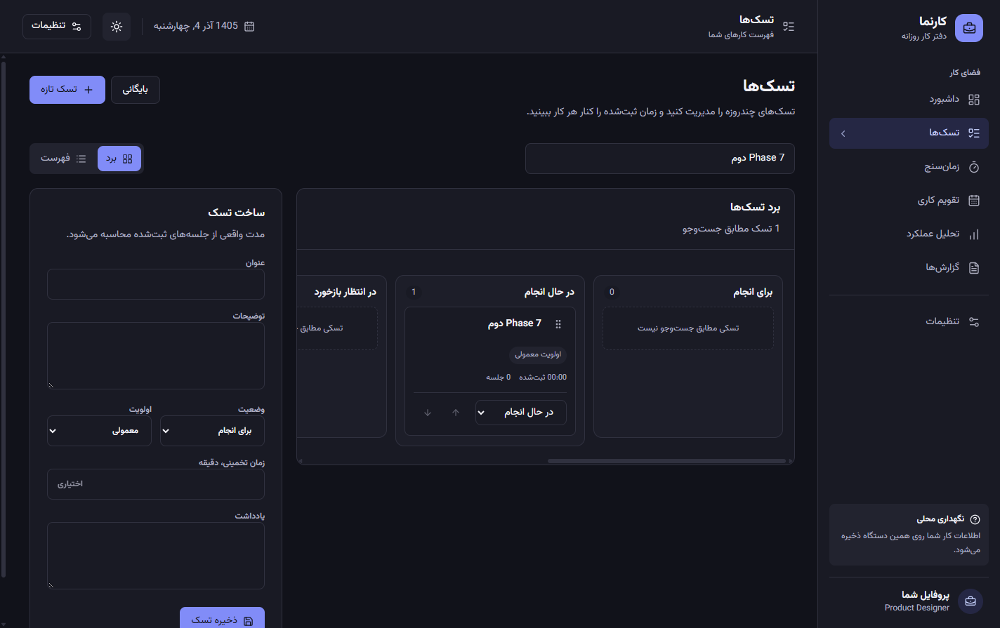

# KARNAMA

KARNAMA is an offline-first, single-user Windows work journal with a Persian, right-to-left interface. Tasks, work sessions, attachments, settings, and backups stay on the user's device.

## Features

- Tasks, manual and timed work sessions, and a Jalali/Gregorian calendar.
- Daily and monthly commitments, analytics, and Persian PDF/HTML reports.
- Task links and local image attachments.
- Manual and scheduled backups with validation and staged restore.
- Archived tasks keep their history; archived-task time is excluded from active reports and becomes reportable again if the task is restored.

## Screenshots

The screenshots use synthetic acceptance-test data.




## Install on Windows

Download `Karnama-0.1.0-win-x64.exe` from the [GitHub Releases page](https://github.com/lifelandsai-collab/KARNAMA/releases/latest), verify its SHA-256 against the release notes, and run the per-user installer. It does not require administrator access.

The installer is not code-signed. Windows may show an unknown-publisher or SmartScreen warning. Check the published checksum and release notes; KARNAMA does not ask you to disable Windows security settings.

KARNAMA currently has no automatic updater. For a later release, make a backup in Settings, download the new installer from the Releases page, and install it over the existing installation. User data is stored separately from the application install folder.

## Requirements and data

- Windows x64 (tested on Windows 10 x64).
- Internet access is not required to use the installed app.
- The app stores its SQLite database and managed attachments in Electron's per-user `userData` directory. The app shows backup locations in Settings; the exact `userData` path depends on the Windows account and installation.
- Uninstalling the application preserves user data. Keep independent copies of backups before replacing a device or profile.

## Development

Use Node.js `24.13.0` or later and npm:

```powershell
npm ci
npm run dev
```

Quality checks and a Windows x64 NSIS installer:

```powershell
npm run typecheck
npm run lint
npm run format:check
npm test
npm run build:app
npm run package:win
```

See [RELEASE.md](RELEASE.md) for packaging, data, restore, and release details; [ARCHITECTURE.md](ARCHITECTURE.md) for implementation notes; and [DEVELOPMENT_PLAN.md](DEVELOPMENT_PLAN.md) for the completed phase record. Release history is in [CHANGELOG.md](CHANGELOG.md).

## Known limitations

- Windows installers are unsigned, and there is no automatic update service.
- Public holidays are entered by the user; they are not bundled or fetched online.
- The app does not record workday start/end, so it cannot infer exact productivity for untracked intervals.
- If timer recovery finds an interval that needs user review, archiving that task waits until the interval is resolved.

## License

KARNAMA is distributed under the [MIT License](LICENSE).

---

## فارسی

کارنما دفتر ثبت کار روزانه برای Windows، آفلاین و تک‌کاربره است. رابط برنامه فارسی و راست‌به‌چپ است و تسک‌ها، جلسه‌های کاری، پیوست‌ها، تنظیمات و نسخه‌های پشتیبان روی دستگاه کاربر نگه‌داری می‌شوند.

### قابلیت‌ها

- مدیریت تسک و ثبت جلسه‌های دستی یا تایمری، همراه تقویم جلالی و میلادی.
- تعهدهای روزانه و ماهانه، تحلیل و گزارش فارسی PDF/HTML.
- پیوند و تصویر محلی برای تسک‌ها.
- پشتیبان‌گیری دستی و زمان‌بندی‌شده، اعتبارسنجی و بازیابی مرحله‌ای.
- تاریخچهٔ تسک بایگانی‌شده حفظ می‌شود؛ زمان آن از گزارش‌های فعال کنار می‌رود و با بازیابی تسک دوباره قابل گزارش است.

### نصب و به‌روزرسانی

فایل `Karnama-0.1.0-win-x64.exe` را از [صفحهٔ انتشار GitHub](https://github.com/lifelandsai-collab/KARNAMA/releases/latest) دریافت کنید، SHA-256 را با یادداشت انتشار تطبیق دهید و نصب‌کنندهٔ per-user را اجرا کنید؛ دسترسی Administrator لازم نیست.

نصب‌کننده امضای کد ندارد؛ ممکن است Windows پیام ناشر ناشناس یا SmartScreen نشان دهد. checksum و یادداشت انتشار را بررسی کنید. برای به‌روزرسانی فعلاً Settings → «پشتیبان‌گیری و بازیابی» یک نسخهٔ پشتیبان بسازید، نصب‌کنندهٔ جدید را از صفحهٔ انتشار بگیرید و روی نسخهٔ موجود نصب کنید. برنامه به‌روزرسان خودکار ندارد.

### داده و توسعه

پایگاه داده و پیوست‌ها در پوشهٔ `userData` مختص کاربر Windows هستند و حذف برنامه این داده‌ها را پاک نمی‌کند. مسیر دقیق بر اساس حساب و نصب Windows تغییر می‌کند. برنامه پس از نصب برای کارکرد به اینترنت نیاز ندارد. برای توسعه، Node.js نسخهٔ `24.13.0` یا جدیدتر و npm لازم است. راهنمای فنی و انتشار در پیوندهای بالای این صفحه آمده‌اند.

کارنما با مجوز [MIT](LICENSE) منتشر می‌شود.
