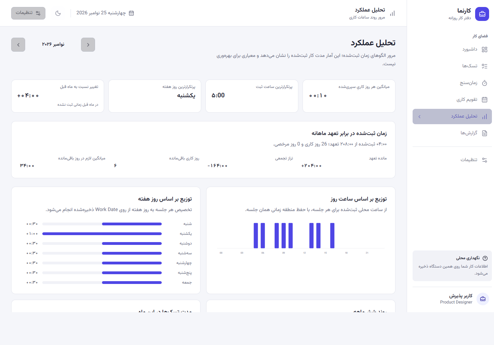

# KARNAMA

**A Persian-first, offline-capable work journal for Windows.** Organize tasks, record real work sessions, compare recorded time with a work schedule, and prepare monthly reports—while keeping the app's data on your device.

کارنما، دفتر ثبت کار روزانهٔ فارسی برای Windows است: تسک‌ها را سامان بدهید، زمان واقعی کار را ثبت کنید و گزارش بگیرید.

> «کارهایت را ثبت کن، زمانت را بشناس، عملکردت را ببین.»

## Key features

- Task Board and List views, status and priority, search, ordering, archive/restore, links, and local image attachments.
- A persistent global timer, manual sessions, and reviewable recovery after an unexpected shutdown.
- Jalali or Gregorian display with distinct Calendar Date and Work Date reporting.
- Work schedules, daily/monthly commitments, holidays, and leave.
- Dashboard, time analytics, and company or personal monthly reports exported as PDF or HTML.
- Manual and scheduled ZIP backups with integrity validation and staged restore.
- Archived-task sessions are excluded from active reports; restoring a task makes its preserved history reportable again.

## Screenshots

These real application screenshots use **synthetic acceptance-test data**, not real user work records.




## Download and install

Download `Karnama-0.1.0-win-x64.exe` from the [KARNAMA Releases page](https://github.com/HadiSharifani/karnama/releases/latest). Verify its SHA-256 against `SHA256SUMS.txt` attached to that release. In PowerShell:

```powershell
Get-FileHash .\Karnama-0.1.0-win-x64.exe -Algorithm SHA256
```

The per-user installer does not require administrator access. It is **not code-signed**; Windows may display an unknown-publisher or SmartScreen warning. A matching checksum confirms file consistency with the published value, not publisher identity. Do not disable Windows security protections.

For first launch and setup, see [Getting Started (English)](docs/GETTING_STARTED_EN.md) or [شروع کار (فارسی)](docs/GETTING_STARTED_FA.md).

## System requirements

- Windows x64. The installer was verified on Windows 11 Pro x64, version 26H2 (build `26300.9818`). Windows 10 has not been separately validated.
- Windows 32-bit is **not supported in v0.1.0**. macOS, Linux, and Windows ARM64 are not release targets.
- Internet access is not required for core features after installation. Opening external task links uses the system browser.
- End users do not need to install Node.js. Developers need Node.js `24.13.0` or later and npm.
- See [System Requirements](docs/SYSTEM_REQUIREMENTS.md) for verified environment and unbenchmarked requirements.

## Documentation

### English

- [Getting Started](docs/GETTING_STARTED_EN.md)
- [User Guide](docs/USER_GUIDE_EN.md)
- [FAQ](docs/FAQ_EN.md)
- [System Requirements](docs/SYSTEM_REQUIREMENTS.md)
- [Employee Guide (Persian)](EMPLOYEE_GUIDE_FA.md)
- [Privacy and Security](docs/PRIVACY_AND_SECURITY.md)
- [Release Notes v0.1.0](docs/RELEASE_NOTES_0.1.0.md)

### فارسی

- [راهنمای کارمندان (فارسی)](EMPLOYEE_GUIDE_FA.md)
- [شروع کار](docs/GETTING_STARTED_FA.md)
- [راهنمای کاربر](docs/USER_GUIDE_FA.md)
- [مدیریت تسک‌ها](docs/TASK_MANAGEMENT_FA.md)
- [تقویم و زمان](docs/CALENDAR_AND_TIME_FA.md)
- [گزارش‌ها و تحلیل عملکرد](docs/REPORTS_AND_ANALYTICS_FA.md)
- [پشتیبان‌گیری و بازیابی](docs/BACKUP_AND_RESTORE_FA.md)
- [رفع اشکال](docs/TROUBLESHOOTING_FA.md)
- [پرسش‌های پرتکرار](docs/FAQ_FA.md)

## Data, privacy, and backups

KARNAMA is a single-user application with no account or cloud sync. Its SQLite database, managed images, and backups stay in the current Windows user's app-data directory. Core task and time features work offline. Uninstalling preserves user data.

Create a manual backup in Settings → Backup and Restore before upgrading or moving devices. Automatic backups are checked while the app is running, roughly once every 24 hours; old backup files are not automatically removed. Backup ZIPs are **not encrypted** by KARNAMA. Protect copies that contain work information. See [Privacy and Security](docs/PRIVACY_AND_SECURITY.md) and the Persian [Backup and Restore guide](docs/BACKUP_AND_RESTORE_FA.md).

## Known limitations and roadmap

- The installer is unsigned and there is no automatic updater.
- Windows 32-bit, Windows ARM64, macOS, and Linux are unsupported in v0.1.0.
- Holidays are entered by the user; they are not fetched from an online calendar.
- KARNAMA reports time that was recorded. It cannot infer untracked work intervals or equate duration with productivity.
- There is no published roadmap or promised delivery timeline. Future proposals can be tracked in [GitHub Issues](https://github.com/HadiSharifani/karnama/issues).
- For common installation, timer, date, or backup problems, see [Troubleshooting (Persian)](docs/TROUBLESHOOTING_FA.md).

## Development and checks

```powershell
npm ci
npm run dev
```

The CI workflow runs on pull requests and pushes to `master` on Windows x64 with Node.js `24.13.0`. To run the same checks locally:

```powershell
npm test
npm run typecheck
npm run lint
npm run format:check
npm run build:app
```

Packaging and verified v0.1.0 installer evidence are documented in [RELEASE.md](RELEASE.md). Architecture notes are in [ARCHITECTURE.md](ARCHITECTURE.md), and product history is in [CHANGELOG.md](CHANGELOG.md).

## فارسی

### دربارهٔ کارنما

کارنما یک دفتر ثبت کار فارسی و آفلاین برای Windows است. تسک‌ها را مرتب کنید، جلسه‌های کاری را با تایمر یا دستی ثبت کنید، زمان را با تعهد کاری مقایسه کنید و گزارش ماهانه بسازید. داده‌های برنامه روی دستگاه کاربر نگه‌داری می‌شوند.

### امکانات

- برد و فهرست تسک، وضعیت و اولویت، جست‌وجو، ترتیب، بایگانی/بازیابی، لینک و تصویر محلی.
- تایمر سراسری، ثبت دستی جلسه و بررسی بازهٔ بازیابی پس از بسته‌شدن غیرمنتظره.
- تقویم شمسی یا میلادی و تفکیک Calendar Date از Work Date.
- برنامهٔ کاری، تعهد روزانه/ماهانه، تعطیلی و مرخصی.
- داشبورد، تحلیل زمان و گزارش ماهانهٔ شرکت یا شخصی با خروجی PDF/HTML.
- ZIP پشتیبان دستی و زمان‌بندی‌شده با اعتبارسنجی و بازیابی مرحله‌ای.
- زمان جلسه‌های تسک بایگانی‌شده از گزارش فعال کنار می‌رود؛ با بازیابی تسک، سابقهٔ حفظ‌شده دوباره گزارش‌پذیر می‌شود.

### تصویرها

تصاویر بالا از برنامهٔ واقعی گرفته شده‌اند و از **دادهٔ آزمایشی ساختگی** استفاده می‌کنند؛ هیچ سابقهٔ واقعی کاربر نمایش داده نشده است.

### نصب و نیازمندی‌ها

فایل `Karnama-0.1.0-win-x64.exe` را از [صفحهٔ انتشار](https://github.com/HadiSharifani/karnama/releases/latest) دریافت و SHA-256 آن را با `SHA256SUMS.txt` تطبیق دهید. نصب‌کنندهٔ per-user دسترسی Administrator نمی‌خواهد اما امضای دیجیتال ندارد و ممکن است هشدار Windows نمایش داده شود. قابلیت‌های اصلی پس از نصب به اینترنت نیاز ندارند. installer روی Windows 11 Pro x64 نسخهٔ 26H2، build `26300.9818` آزموده شده است؛ Windows 10 جداگانه اعتبارسنجی نشده است. Windows 32-bit پشتیبانی نمی‌شود؛ macOS، Linux و ARM64 نیز هدف انتشار نیستند.

### حریم خصوصی و پشتیبان

برنامه حساب یا همگام‌سازی ابری ندارد. پایگاه داده، تصاویر و ZIPهای پشتیبان در پوشهٔ دادهٔ حساب Windows قرار می‌گیرند و uninstall آن‌ها را نگه می‌دارد. پیش از ارتقا یا جابه‌جایی، یک نسخهٔ دستی بسازید و بیرون از دستگاه کپی کنید. ZIPها رمزگذاری نمی‌شوند؛ از رسانهٔ محافظت‌شده استفاده کنید.

### مستندات

برای راهنمای یک‌جای نصب و استفادهٔ کارکنان، [راهنمای کارمندان (فارسی)](EMPLOYEE_GUIDE_FA.md) را ببینید. جزئیات بیشتر در راهنمای [شروع کار](docs/GETTING_STARTED_FA.md)، [مدیریت تسک](docs/TASK_MANAGEMENT_FA.md)، [تقویم و زمان](docs/CALENDAR_AND_TIME_FA.md)، [گزارش‌ها](docs/REPORTS_AND_ANALYTICS_FA.md)، [پشتیبان‌گیری](docs/BACKUP_AND_RESTORE_FA.md)، [رفع اشکال](docs/TROUBLESHOOTING_FA.md)، [نیازمندی سیستم](docs/SYSTEM_REQUIREMENTS.md) و [یادداشت انتشار](docs/RELEASE_NOTES_0.1.0.md) آمده است.

### توسعه

برای اجرا در محیط توسعه، Node.js نسخهٔ `24.13.0` یا جدیدتر و npm لازم است. دستورهای نصب و بررسی کیفیت در بخش انگلیسی بالا هستند؛ جزئیات بسته‌بندی در [RELEASE.md](RELEASE.md) قرار دارد.

## About and credits

- **Product:** KARNAMA
- **Main product creator:** Mohammad Hadi Sharifani
- **Product team display name:** KARNAMA Team
- **License:** [MIT](LICENSE)
